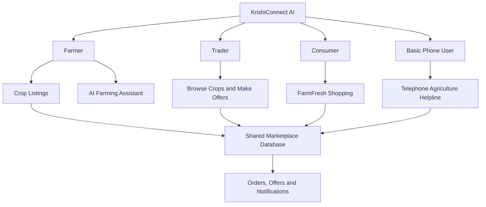
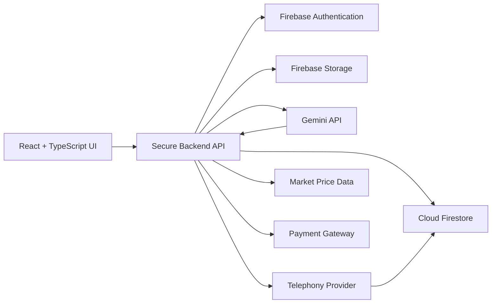

# farmer-help
this web or app use a help related with farming


### Empowering Farmers. Connecting Markets. Growing Futures.

<p align="center">
  <strong>An AI-Powered Agriculture Ecosystem for Indian Farmers, Traders & Consumers</strong>
</p>

<p align="center">
  🌾 Smart Farming • 🛒 Direct Marketplace • 🤖 AI Assistance • 📞 Voice Helpline
</p>

<p align="center">
  
  
  
  
</p>

---

## 🚀 About the Project

**KrishiConnect AI** is an AI-powered agricultural platform designed to make farming smarter, agricultural trading more transparent, and fresh produce more accessible.

Indian farmers often face challenges such as limited access to agricultural experts, unpredictable market prices, dependence on middlemen, crop diseases, and difficulties finding reliable buyers.

KrishiConnect AI brings farmers, traders, and consumers together in one digital ecosystem. It combines AI-powered farming assistance, a crop trading marketplace, direct farm-to-consumer shopping, and a telephone-based agricultural service for farmers who do not own smartphones.

Our mission is simple:

> 🌱 Help farmers grow smarter, sell fairly, and connect directly with the people who value their produce.

## 🎯 Our Vision

Build a farmer-first digital ecosystem where technology makes agricultural knowledge easier to access, market opportunities more transparent, and direct selling more convenient.

## ✨ Key Features

### 🤖 1. AI Farming Assistant

Get agricultural guidance through an AI-powered assistant using Google's Gemini API.

- Ask farming questions in English, Hindi, and Marathi.
- Get general guidance on irrigation, soil health, crop care, and pest management.
- Upload crop images or describe symptoms for possible disease identification.
- Receive clarifying questions when information is insufficient.
- Access voice input and spoken responses where supported.
- Receive safety reminders for pesticide use and recommendations to consult agricultural experts when needed.

### 🌿 2. AI Crop Doctor

Help farmers investigate potential crop problems using photos and symptom descriptions.

- Upload leaf or crop photographs.
- Describe visible symptoms in a familiar language.
- Explore possible causes and preventive measures.
- Receive cautious, educational guidance.
- Request assistance from a qualified agricultural expert when needed.

*AI-generated crop assessments are informational, not guaranteed diagnoses.*

### 🧑‍🌾 3. Farmer Dashboard

Give farmers a central place to manage their agricultural business.

- Create and manage crop listings.
- Upload crop photographs and product details.
- Track available stock and expected harvest dates.
- View trader offers and compare prices.
- Manage consumer orders and buyer inquiries.
- Track completed and pending transactions.
- View sales activity and estimated earnings.

### 🏪 4. Trader Marketplace

Connect agricultural traders directly with farmers.

- Browse available crops and produce.
- Search and filter by crop, location, quantity, quality, and price.
- Submit purchase offers with quantities and expiry dates.
- Compare farmer listings and available offers.
- Contact farmers through consent-controlled calling or messaging.
- Track offer and transaction statuses.

### 🛒 5. FarmFresh Market — Direct Farmer-to-Consumer Shopping

**Fresh from the farm, directly to your home.**

FarmFresh Market allows farmers to sell produce directly to households, restaurants, grocery stores, and local buyers.

**For farmers:**
- Create a digital storefront.
- List vegetables, fruits, grains, pulses, and other farm products.
- Set prices, product quantities, and availability.
- Manage customer orders and inventory.
- Offer local delivery or farm pickup where available.

**For consumers:**
- Browse fresh farm products.
- Search by product, category, and location.
- View product photos, prices, and farmer details.
- Add products to a shopping cart.
- Place orders and track order status.
- Contact farmers when permitted.
- Review completed purchases.

This marketplace aims to make direct agricultural trade easier and reduce unnecessary intermediaries where practical.

### 📞 6. KrishiConnect AI Phone Service

**Agricultural assistance for farmers without smartphones.**

The telephone service is designed for farmers who use basic keypad phones or have limited internet access.

- Inbound agricultural helpline with configurable telephony integration.
- Marathi, Hindi, and English language menus where supported.
- Keypad-based navigation and speech interaction where available.
- AI-powered agricultural questions and spoken responses.
- Crop disease reporting.
- Available market-price information.
- Crop registration through a telephone conversation.
- Human agricultural expert callback requests.
- Trader callback requests with farmer consent.

If no telephony provider is configured, a clearly labelled demo simulator demonstrates the intended workflow.

### 🎙️ 7. Voice-Based Farming Assistance

Make agricultural information more accessible to users who prefer speaking.

- Microphone-enabled question input.
- Transcript review before submission.
- Text-to-speech responses.
- Manual typing fallback.
- Language selection and helpful permission messages.

Voice capabilities depend on browser, device, and configured speech services.

### 📝 8. AI-Powered Crop Registration

Farmers can describe their produce naturally instead of completing a complicated form.

Example:

> “I have 500 kilograms of onions in Nashik, ready for sale.”

The application can extract available information such as crop name, quantity, location, expected price, and availability.

Farmers review and correct the details before publishing. Missing information is not invented.

### 📊 9. Agricultural Market Price Assistant

Help farmers explore available crop-price information.

- Crop name and market location.
- Price per quintal.
- Market and data source.
- Last-updated timestamp.
- Market comparisons where reliable data is available.
- Clear demonstration labels when live data is unavailable.

The platform is designed to use genuine agricultural market data sources when access is configured. Demonstration prices are never represented as verified live prices.

### 🌦️ 10. Smart Weather and Crop Alerts

Provide relevant weather information and agricultural reminders when connected to reliable weather services.

- Local weather alerts.
- Heavy rainfall and heat notifications.
- Irrigation planning support.
- Harvest and storage reminders.
- Weather-aware farming suggestions.

Alerts depend on configured data sources and must not be treated as guaranteed forecasts.

### 🧪 11. Soil Health Assistant

Help farmers understand soil-test reports and basic soil-health information.

- Explain soil pH and nutrient values.
- Interpret farmer-provided soil-test results.
- Offer general soil-care guidance.
- Encourage appropriate soil testing and expert consultation.

Recommendations are based on available information; missing soil measurements are never fabricated.

### 💰 12. Farming Profit Calculator

Help farmers understand the economics of crop production.

- Record seeds, fertilizers, labour, irrigation, and other costs.
- Include transport and packaging expenses.
- Calculate total production costs.
- Estimate revenue and net profit or loss.
- Calculate the break-even selling price.

All results depend on the values entered by the farmer and are estimates, not guaranteed earnings.

### 👥 13. Group Selling

Allow farmers to coordinate bulk sales of the same crop.

- Create or join a group sale.
- Combine quantities from participating farmers.
- Share bulk listings with traders.
- Receive offers for larger quantities.
- Track each farmer's contribution.
- Require each participant's approval for their own commitments.

Group selling can improve market access and logistics, depending on demand, transport, and local conditions.

### 🛡️ 14. Verified Trader and Deal Protection

Encourage safer and more transparent agricultural transactions.

- Trader verification workflow.
- Offer history and transaction records.
- Consent-controlled phone contact.
- Private in-app messaging.
- Order and delivery status tracking.
- Payment status records.
- Dispute and suspicious-activity reporting.

Verification badges are awarded only after the required verification process. The platform does not guarantee that every transaction will be successful.

### 🏛️ 15. Government Scheme Finder

Help farmers discover relevant agricultural programs and official resources.

- Explore potentially relevant schemes and subsidies.
- Review eligibility criteria.
- Find document checklists.
- Access official application links.
- Check deadlines when verified information is available.

Eligibility guidance does not constitute government approval or guarantee a benefit.

---

## 👥 User Roles

| Role | Main capabilities |
|---|---|
| 🧑‍🌾 Farmer | Manage crops, receive offers, sell directly, manage orders, access AI assistance |
| 🏪 Trader | Discover produce, compare listings, submit offers, contact sellers |
| 🛍️ Consumer | Browse products, shop, place orders, and track purchases |
| 🧑‍💼 Agricultural Expert | Handle assigned support requests through authorized workflows |
| 🛡️ Administrator | Manage authorized verification, moderation, and platform operations |

Role permissions must be enforced by the backend and database security rules, not just by hiding frontend buttons.

## 🔄 How It Works



## 🛠️ Technology Stack

The following technologies are planned for the application; the actual stack depends on the implemented project configuration.

| Layer | Technology |
|---|---|
| Frontend | React, TypeScript, Vite |
| Styling | Tailwind CSS and responsive UI components |
| AI | Google Gemini API |
| Backend | Node.js, Express, TypeScript |
| Authentication | Firebase Authentication |
| Database | Cloud Firestore |
| Image Storage | Firebase Storage |
| Voice Input | Browser speech-recognition APIs or configured speech services |
| Voice Output | Browser speech synthesis or configured text-to-speech service |
| Telephony | Configurable provider such as Exotel or Twilio |
| Payments | Optional gateway integration, such as Razorpay |
| Market Data | Authorized agricultural market-price data source, when available |

## 🏗️ System Architecture



The backend validates requests, checks user permissions, protects credentials, and coordinates external services. Optional integrations remain unavailable until properly configured.

## 🔐 Security and Privacy

KrishiConnect AI is designed around responsible handling of farmer and customer information.

- Server-side storage of Gemini and telephony secrets.
- Authentication and role-based access controls.
- Database security rules for listings, offers, orders, and conversations.
- Ownership checks for farmer products and customer orders.
- Input validation and rate limiting.
- Consent-controlled phone-number sharing.
- Verification of telephony webhooks where supported.
- Secure handling of payment verification.
- Restricted access to personal information.
- Clear distinction between demonstration and production data.

## 🚀 Getting Started

### Prerequisites

Install the required tools and create accounts for the services you intend to configure.

- Node.js and npm.
- Firebase project.
- Gemini API key.
- Git.
- Telephony provider account, if testing real inbound calls.
- Market-price API credentials, if available.
- Payment gateway account, if enabling online payments.

### Installation

Clone your repository:

```bash
git clone <YOUR_REPOSITORY_URL>
cd <YOUR_PROJECT_DIRECTORY>
npm install
```

If the frontend and backend use separate directories, install dependencies in each directory according to the project's structure.

### Environment Variables

Create a `.env` file or the appropriate server-side environment configuration using `.env.example` as a template.

```env
# Server-side Gemini configuration
GEMINI_API_KEY=your_gemini_api_key

# Firebase configuration
FIREBASE_PROJECT_ID=your_firebase_project_id
FIREBASE_CLIENT_EMAIL=your_service_account_email
FIREBASE_PRIVATE_KEY=your_service_account_private_key

# Telephony configuration
TELEPHONY_PROVIDER=your_provider
TELEPHONY_ACCOUNT_ID=your_account_id
TELEPHONY_AUTH_TOKEN=your_auth_token
AGRICULTURE_HELPLINE_NUMBER=your_configured_number

# Application
APP_BASE_URL=http://localhost:3000

# Optional integrations
MARKET_PRICE_API_KEY=
PAYMENT_GATEWAY_KEY=
PAYMENT_GATEWAY_SECRET=
```

These values are placeholders. Use the exact variable names expected by your implementation. Keep server secrets out of frontend environment variables, public repositories, and client-side bundles. Use managed secrets for production deployments.

### Run the Application

The exact commands depend on your generated project. A typical separate frontend/backend setup may use:

```bash
# Frontend
npm run dev

# Backend, in its own directory
npm run dev
```

Configure Firebase Authentication, Firestore rules, and Storage rules before testing production-style workflows.

### Demo Mode

Demo mode should include fictional farmers, traders, consumers, products, offers, and sample prices.

- Clearly label seeded records.
- Use simulated phone calls when telephony is not configured.
- Keep demo and production data separate.
- Never represent sample transactions, prices, or AI outputs as verified real-world results.

## 🧪 Key Demo Workflows

1. A farmer registers and publishes an onion listing.
2. A trader discovers the listing and submits an offer.
3. The farmer reviews and responds to the offer.
4. A consumer finds a nearby farmer and adds vegetables to their cart.
5. The farmer accepts the consumer's order and updates its status.
6. A farmer asks the AI assistant a crop-care question.
7. A basic-phone user completes the simulated telephone crop-registration flow.
8. The resulting crop listing appears in the shared marketplace.
9. A farmer requests an agricultural expert callback and receives a reference number.
10. Unauthorized users are prevented from changing listings
